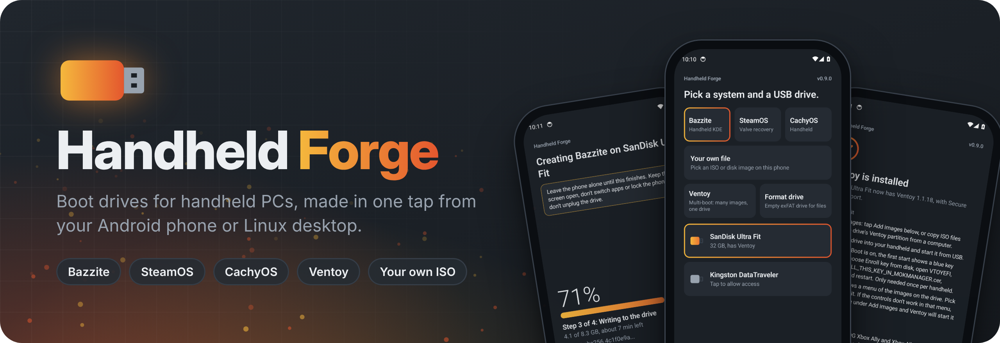
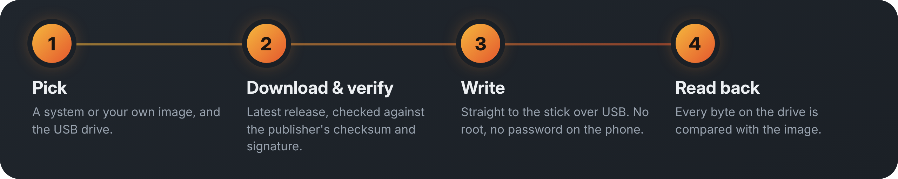
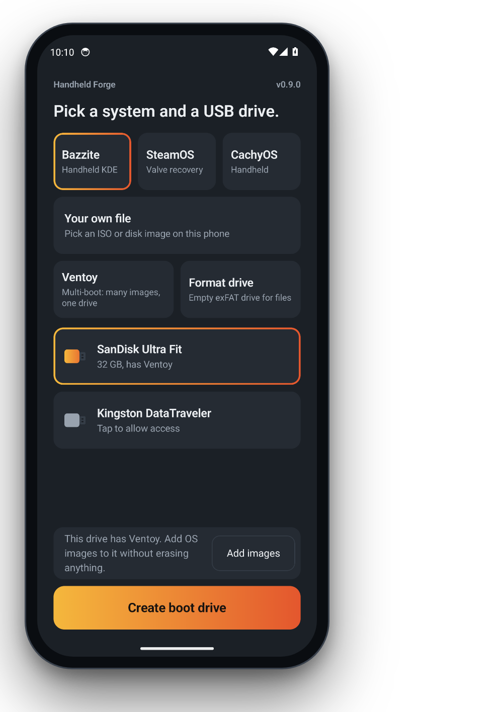
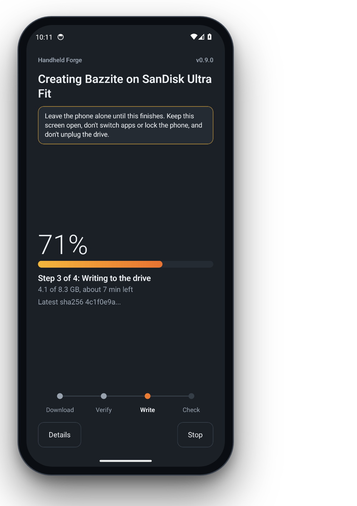
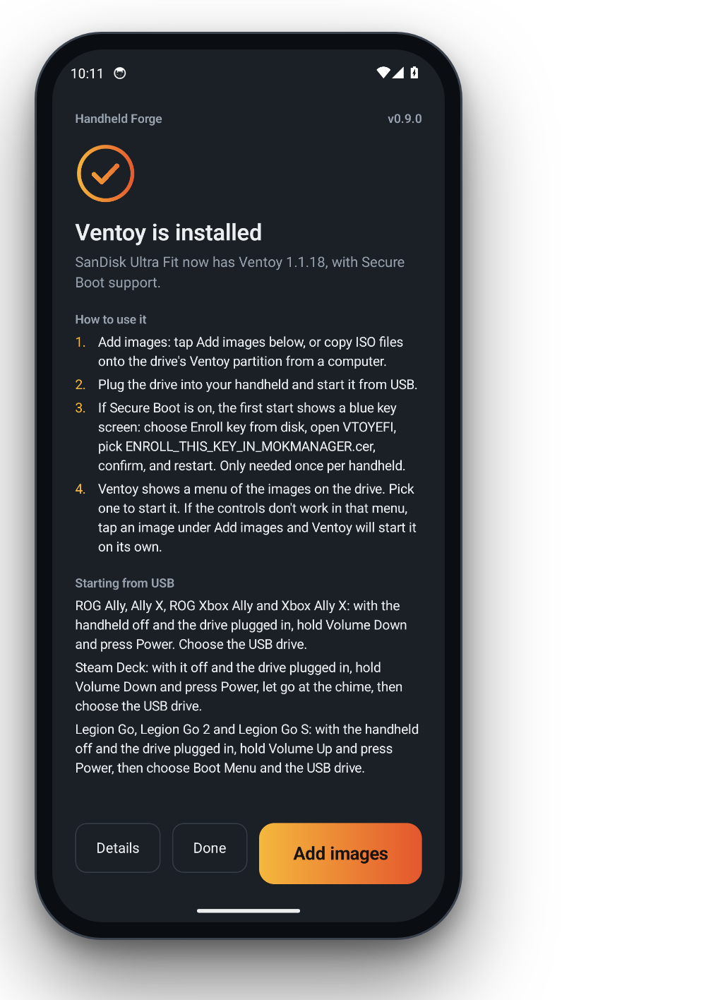
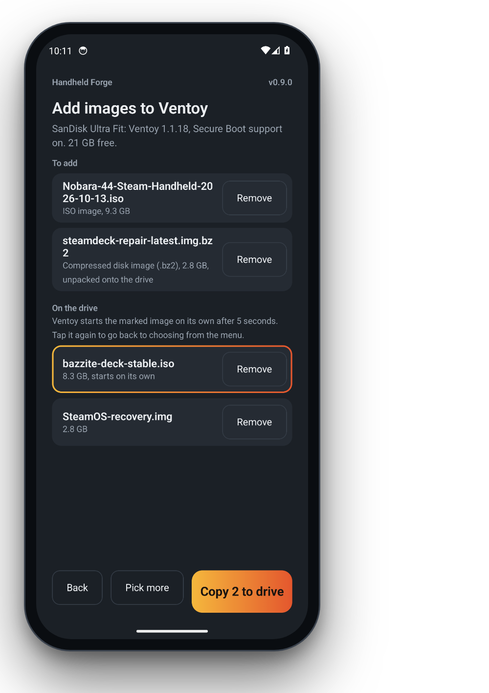

<p align="center">
  
</p>

<p align="center">
  <a href="https://github.com/Ravenor907/Handheld-Forge/releases"></a>
  <a href="https://github.com/Ravenor907/Handheld-Forge/actions/workflows/android.yml"></a>
  <a href="LICENSE"></a>
</p>

Plug a USB stick into your phone. Tap a system. Go get a snack. Come back to a boot drive for your Steam Deck, ROG Ally or Legion Go.

No root, no terminal, no `dd` roulette.

<p align="center"></p>

## What it does

<table>
<tr>
<td width="33%"><br><b>One-tap systems</b><br>Bazzite, SteamOS and CachyOS, fresh from the source.</td>
<td width="33%"><br><b>Your own file</b><br>Any ISO or disk image on your phone, even <code>.xz</code>, <code>.gz</code>, <code>.bz2</code> or <code>.zip</code>.</td>
<td width="33%"><br><b>Ventoy</b><br>One stick, every OS. Installs the latest release, Secure Boot on or off.</td>
</tr>
<tr>
<td><br><b>Add images</b><br>Drop ISOs onto a Ventoy stick straight from your phone. Compressed ones get unpacked.</td>
<td><br><b>Starts on its own</b><br>Controller dead in Ventoy's menu? Mark an image and it boots itself.</td>
<td><br><b>Format drive</b><br>Turns a used boot stick back into a normal exFAT drive.</td>
</tr>
<tr>
<td><br><b>Checked twice</b><br>Downloads are checked, and every byte is read back off the stick.</td>
<td><br><b>Fast</b><br>Unpacks on every CPU core while the stick writes.</td>
<td><br><b>Stubborn</b><br>Dropped Wi-Fi resumes. Flaky adapter? It slows down and keeps going.</td>
</tr>
</table>

## Screenshots

<table>
<tr>
<td align="center"><br>Pick</td>
<td align="center"><br>Write</td>
<td align="center"><br>Done</td>
<td align="center"><br>Add to Ventoy</td>
</tr>
</table>

## Get it

**Android:** grab the APK from [Releases](https://github.com/Ravenor907/Handheld-Forge/releases) and plug the stick in with a USB-C adapter. Android asks once if the app can use the stick. Say yes.

**Linux desktop** (Bazzite, SteamOS desktop mode, most distros):

```bash
git clone https://github.com/Ravenor907/Handheld-Forge.git
cd Handheld-Forge && ./install.sh
```

Then open **Handheld Forge** from your app menu. Bazzite needs no password. SteamOS and CachyOS ask for it once, because Linux.

## Systems

| | Android | Linux desktop |
| --- | :---: | :---: |
| Bazzite (Handheld KDE) | ✓ | ✓ |
| SteamOS (Valve recovery image) | ✓ | ✓ |
| CachyOS Handheld | ✓ | ✓ |
| Your own ISO or image | ✓ | |
| Ventoy, add images, format | ✓ | |

## It won't eat your laptop

Only USB drives show up. The drive your system runs from is never offered, and erasing always asks first, by name.

## The fine print

Everything else (how each part works, desktop options, command line, adding a system, development) is in [docs/details.md](docs/details.md).

GPL-3.0. Made by [Ravenor907](https://github.com/Ravenor907). Not affiliated with Bazzite, Valve, CachyOS or Ventoy, just a fan of all four.
